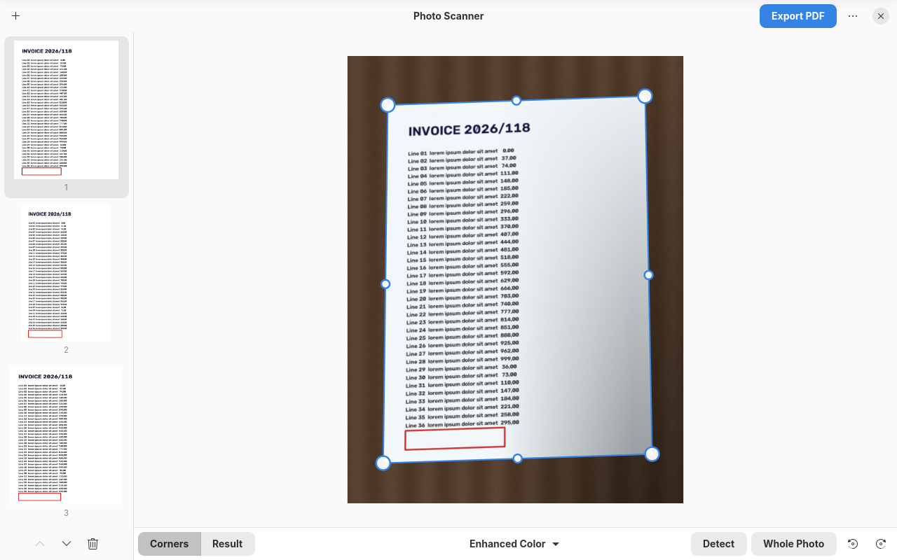

# Photo Scanner

Turn photos of documents into clean scans and PDF files — on your computer,
without an account or a cloud service.



Take a picture of a document, a receipt or a page of notes with your phone,
open it in Photo Scanner and you get a straight, clean scan:

- the sheet of paper is **found automatically**, even on a table of a similar
  color or on a patterned tablecloth;
- **corners and sides can be adjusted by hand**, with a magnifier for precision;
- **shadows and uneven lighting are removed**;
- filters: **enhanced color**, **grayscale**, **black and white**, or the original;
- pages can be rotated and reordered (also by dragging them);
- export a **multi-page PDF** (A4 pages, or pages the size of the document)
  or one image per page;
- opens JPEG, PNG, HEIC/HEIF, WebP, AVIF, JPEG XL, TIFF and more.

Photo Scanner is written in Python with GTK 4 and libadwaita; the image processing
uses OpenCV and NumPy.

## Install

Download `PhotoScanner-<version>-x86_64.flatpak` from the
[latest release](https://github.com/Duilio97/photoscanner/releases/latest) and open it
with your software center, or install it from a terminal:

```sh
flatpak install --user PhotoScanner-1.0.0-x86_64.flatpak
```

The GNOME runtime it needs is downloaded from Flathub automatically.
Updates are not automatic: install the file of a newer release to update.

### Build from the sources

```sh
flatpak install flathub org.flatpak.Builder org.gnome.Sdk//51
flatpak run org.flatpak.Builder --user --install --force-clean build-dir \
    build-aux/flatpak/io.github.duilio97.PhotoScanner.json
flatpak run io.github.duilio97.PhotoScanner
```

The first build compiles NumPy and OpenCV and takes a while.

## Development

Run the tests (they create synthetic photos: pages in perspective on wood,
dark, light, checked and striped tables, with shadows):

```sh
python3 -m unittest discover -s tests -v
```

Build and validate with Meson:

```sh
meson setup _build
meson test -C _build
```

## Translations

Translations live in `po/`. To add a language, copy `po/photoscanner.pot` to
`po/<language>.po`, translate it and add the language code to `po/LINGUAS`.

## License

Photo Scanner is free software: GNU General Public License, version 3 or later.
See [LICENSE](LICENSE).
